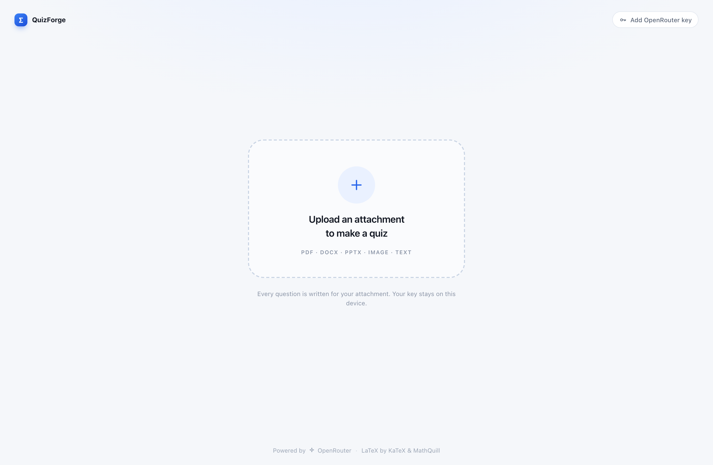
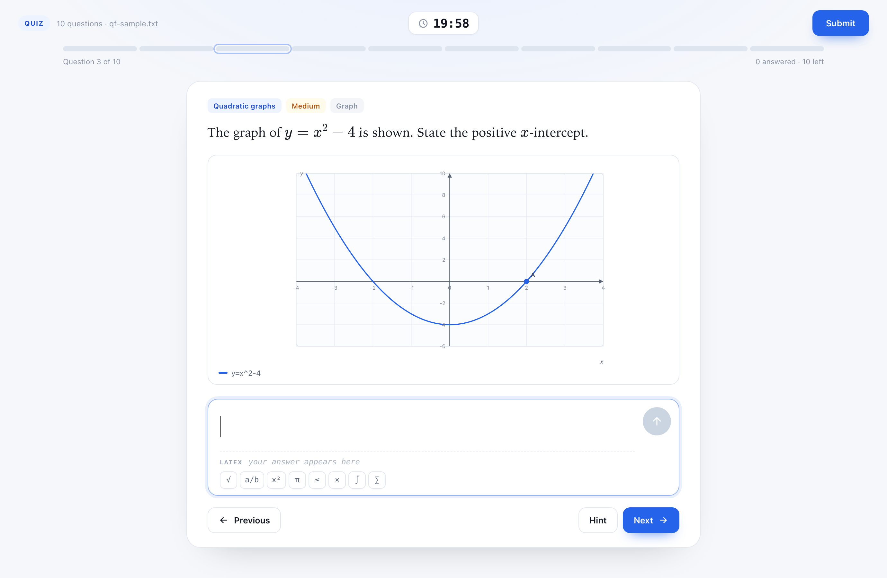
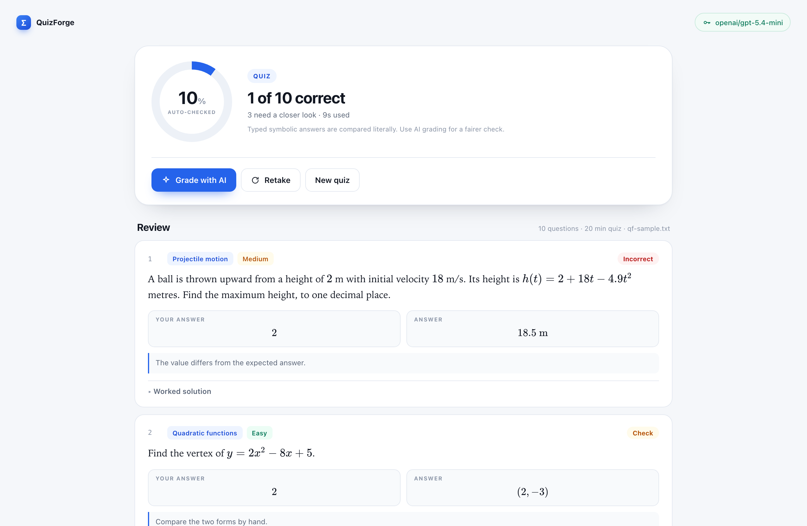
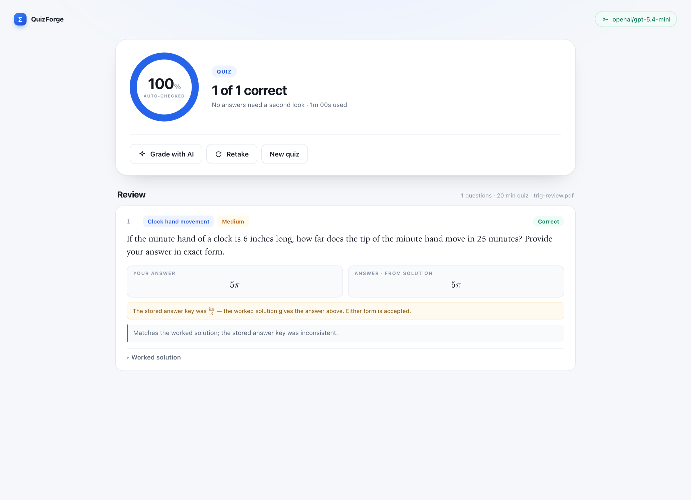

# QuizForge

**Drop in a document. Get a timed quiz.** QuizForge reads an attachment, writes a
set of detailed questions about it, and runs them as a 10-question quiz (20
minutes) or a 20-question test (40 minutes). Answers are typed in MathQuill,
every formula is rendered with LaTeX, and graphs are drawn from the questions
themselves.

Built with **Tauri 2** — a native webview and a ~9 MB binary, not an Electron
bundle.



## What it does

- **Any attachment** — PDF, DOCX, PPTX, Markdown, text, HTML, Jupyter
  notebooks, or an image (images need a vision-capable model).
- **A consistent question format** — every question has the same structure:
  topic, difficulty, a stem, a typed final answer, a worked solution, an
  optional hint, and an optional graph.
- **Detailed questions, not trivia** — word problems with inline math,
  direct symbolic tasks, and graph questions. The model is told to require at
  least two reasoning steps and to avoid yes/no or recall items.
- **Quiz or test** — 10 questions / 20 minutes, or 20 questions / 40 minutes,
  chosen after the upload.
- **A real exam screen** — timer above the segmented progress bar, blue for
  answered, grey for unanswered, click any segment to jump. The timer
  auto-submits at zero.
- **MathQuill input** — a rendered math field with a live LaTeX line and a
  circular send button. Toolbar shortcuts for fractions, roots, powers,
  integrals and sums.
- **Graphs** — question graphs (functions, points, segments, shading, axes and
  ticks) are drawn as SVG. No image generation, no canvas fuzz.
- **Results** — auto-checking for numeric and exact answers, a side-by-side
  review, worked solutions, and optional **AI grading** for symbolic answers.
- **Grading that survives a bad answer key** — if the stored `answer` disagrees
  numerically with the final line of the worked solution, the solution wins.
  Both values are accepted, the solution's value is shown as the answer, and the
  inconsistency is called out instead of marking a correct student wrong.
- **Resumable** — closing the app mid-quiz preserves answers, drafts, the
  current question and the absolute deadline.
- **OpenRouter only** — one key, one provider, all model choice left to you.





When the answer key and the explanation disagree, QuizForge shows the
solution's value and accepts either form:



## Requirements

- **Node 20+**
- **Rust** (stable, 1.77+) via [rustup](https://rustup.rs)
- **macOS**: Xcode Command Line Tools (`xcode-select --install`)
- **Windows**: WebView2 (included in Windows 11), the MSVC build tools, and
  Rust's `x86_64-pc-windows-msvc` target

## Run it

```bash
npm install
npm start          # tauri dev — opens the app
```

The same app also runs in a browser, calling OpenRouter directly (its API
allows CORS):

```bash
npm run dev        # http://localhost:1420
```

Browser mode is fully functional — real uploads, real model calls, MathQuill,
KaTeX, graphs, the timer and results. The key is kept in `localStorage` there;
the desktop build keeps it in the app-data store and makes requests through
Rust, so it never travels through the webview's network stack.

## Connect OpenRouter

1. Create a key at <https://openrouter.ai/keys>.
2. Click **Add OpenRouter key** in the app.
3. Pick any model from the 400+ live catalogue, or type a model ID directly.
   The default is `openai/gpt-5.4-mini`.
4. **Save key.** QuizForge verifies it against OpenRouter before saving.

The key is stored locally in the app data folder. Only the extracted text (and
an image, if you attached one) is sent to OpenRouter — never the original file.

Some suggestions:

| Model | Why |
| --- | --- |
| `openai/gpt-5.4-mini` | Good balance of reasoning quality and price |
| `anthropic/claude-sonnet-4.6` | Strongest worked solutions |
| `google/gemini-3.5-flash` | Fast and cheap, long context |
| `anthropic/claude-haiku-5.5` | Cheapest tier that still writes solid math |

Any vision-capable model can read image attachments.

## Build installers

```bash
npm run dist       # for the current platform
npm run dist:mac   # macOS only
```

Outputs:

- macOS: `src-tauri/target/release/bundle/dmg/*.dmg` and `.../macos/QuizForge.app`
- Windows: `src-tauri/target/release/bundle/nsis/*-setup.exe`

Windows builds must be produced on Windows (or by CI); NSIS and MSI bundling are
not cross-compiled reliably from macOS.

### Both platforms from GitHub Actions

`.github/workflows/release.yml` builds a universal macOS DMG (Apple silicon +
Intel) and a Windows NSIS installer on every `v*` tag, then attaches them to a
GitHub release.

```bash
git tag v1.0.1
git push origin v1.0.0
```

Builds are unsigned. On macOS, right-click the app and choose **Open** the first
time; on Windows, SmartScreen may ask you to confirm.

## How the questions are made

1. The attachment is converted to text in the webview (pdf.js, mammoth,
   JSZip), or kept as an image for vision models.
2. The text is split into passages. A difficulty/type plan is created for the
   chosen mode.
3. Small batches (4 questions) are requested from OpenRouter with a strict JSON
   schema. Each batch gets the plan slots, a passage, and the list of questions
   already written so it does not repeat setups.
4. Every response is parsed and validated: the stem, answer, worked steps,
   choice of type, and — for graph questions — that the graph spec compiles and
   has something to draw.
5. Valid, non-duplicate questions are kept until the quiz is full. If a batch
   fails, it is retried; rate limits are respected.

The system prompt treats the attachment as **material, not instructions**, and
requires a single checkable final answer per question.

## Data and privacy

- Questions, answers, drafts and settings live in the Tauri app-data folder
  (`~/Library/Application Support/app.quizforge.desktop/` on macOS,
  `%APPDATA%\app.quizforge.desktop\` on Windows).
- The OpenRouter key is stored in that local JSON file in plain text. Remove it
  from Settings if you share the machine.
- Nothing is sent anywhere except OpenRouter, and only when you generate,
  verify a key, or ask for AI grading.
- The app loads no remote assets; KaTeX, MathQuill and the fonts are bundled.

## If something goes wrong

- **`HTTP 402 — requires more credits`** — OpenRouter checks `max_tokens` against
  your balance before running. QuizForge retries with the number of tokens your
  account can actually afford, but a full quiz still needs credit. Add credit at
  <https://openrouter.ai/settings/credits> or pick a model whose id ends in
  `:free`.
- **Answer keys look wrong** — switch to a stronger model in Settings. The
  earlier default, `openai/gpt-4o-mini`, is cheap but makes avoidable arithmetic
  mistakes on multi-step problems; `openai/gpt-5.4-mini` and above are much
  better. Then regenerate.
- **A graph is rejected** — the model's graph spec did not compile or had
  nothing drawable, so that question is dropped and the generator asks for
  another. A stronger model makes this rare.
- **An image is not read** — choose a vision-capable model.

## Limits

- Attachments up to 40 MB; extraction uses the first ~320,000 characters.
- A quiz has a fixed 10 or 20 questions, and the timer is 20 or 40 minutes.
- Typed symbolic answers are auto-checked literally (and numerically where
  possible). Use **Grade with AI** on the results screen for a fair comparison
  of equivalent forms — that costs one extra model call.
- If the model cannot fill the requested count, the quiz uses however many
  unique questions it produced and says so.

## Layout

```
src/                 frontend (Vite, vanilla JS)
  lib/bridge.js      Tauri IPC, file picker, store, browser mock
  lib/extract.js     PDF / DOCX / PPTX / text / image extraction
  lib/prompts.js     the exam-author prompt and JSON schema
  lib/questions.js   mode plans, validation, duplicate detection
  lib/generate.js    batched generation loop
  lib/graph.js       SVG graph renderer
  lib/expression.js  a small expression parser for graph specs
  lib/rich.js        KaTeX rendering + MathQuill fields
  lib/mathcheck.js   normalisation and numeric checking
  lib/grade.js       local + AI grading
  ui/                screens, settings, overlays
src-tauri/           Rust: OpenRouter HTTP, file reads, plugins
tests/                node:test suite for the grading rules
scripts/make-icon.mjs  reproducible app icon (pure Node)
```

## Tests

```bash
npm test           # grading rules: solution-vs-key reconciliation
```

The browser build is fully exercisable, so the flow can also be driven with
Playwright against `npm run dev`. `src/lib/bridge.js` has no fixtures: the
browser and desktop builds both call the real OpenRouter API.

## License

MIT. See [LICENSE](LICENSE).
